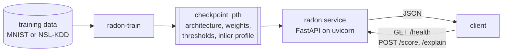

# RADON inference service

An HTTP service, in the optional `service` extra, that loads one trained checkpoint and returns
anomaly scores and, for tabular models, per-feature attributions.



## Train a small model

```bash
pip install torch torchvision --index-url https://download.pytorch.org/whl/cpu
pip install -e ".[service]"
python -m radon.cli.train --config configs/mnist.yaml --set training.epochs=1 --set training.warmup_epochs=1
```

This writes `outputs/checkpoints/radon_mnist_rep0.pth` in about 20 s on a laptop CPU; MNIST
downloads on the first run. Checkpoints of tabular datasets (`configs/nsl_kdd.yaml`) also store
the inlier profile that `/explain` needs.

## Start the service

```bash
RADON_CHECKPOINT=outputs/checkpoints/radon_mnist_rep0.pth \
    uvicorn radon.service.app:create_app --factory --port 8000
```

In PowerShell, set the variable first: `$env:RADON_CHECKPOINT = "outputs/checkpoints/radon_mnist_rep0.pth"`.
In Docker (PowerShell: `${PWD}` instead of `$(pwd)`):

```bash
docker build --target service -t radon:service .
docker run --rm -p 8000:8000 -v "$(pwd)/outputs:/app/outputs" \
    -e RADON_CHECKPOINT=outputs/checkpoints/radon_mnist_rep0.pth radon:service
```

## Requests

The responses below come from the checkpoint trained above.

```bash
curl localhost:8000/health
```
```json
{"status":"ok","model_loaded":true,"architecture":{"input_dim":784,"hidden_dim":256,"latent_dim":128},
 "checkpoint_radon_version":"0.1.0","trained_on":"mnist","device":"cpu","max_batch_size":1024,
 "score_threshold":null,"explain_available":false}
```

`/score` takes records preprocessed like the training data: `input_dim` values in `[0, 1]`.

```bash
python -c "import json; print(json.dumps({'records': [[0.5] * 784, [1.0] * 784]}))" > body.json
curl -X POST localhost:8000/score -H "content-type: application/json" --data @body.json
```
```json
{"scores":[0.5013881921768188,0.5163087844848633],"threshold":null,"above_threshold":null}
```

Invalid input is rejected with 422 and the reason, for example
`{"detail":"Record 0 has 2 feature(s); the model expects 784."}` or, for a value above 1,
`{"detail":[{"loc":["body","records",0,0],"msg":"Input should be less than or equal to 1",...}]}`.

`/explain` needs a tabular checkpoint; this MNIST one answers 409:

```bash
curl -X POST localhost:8000/explain -H "content-type: application/json" -d '{"record": [0.5, 0.5]}'
```
```json
{"detail":"Feature attribution is only available for tabular checkpoints: this checkpoint was trained on 'mnist'."}
```

On a tabular checkpoint it returns the score and the attributions. Abridged, from the untrained
six-feature checkpoint used in `tests/test_service.py`, so the values only show the format:

```json
{"score":0.1695,"threshold":null,"above_threshold":null,
 "categorical":[{"group":"flag","observed":[["REJ",1.0],["SF",0.0]],"baseline":"SF",
                 "delta_score":-0.0231,"mismatch":true}],
 "numeric":[{"index":1,"name":"src_bytes","value":0.95,"reconstruction":0.5645,
             "quantile_low":0.2039,"quantile_high":0.2458,"outside_range":true,
             "delta_score":0.0691,"prefers_inverted_target":false}]}
```

A negative `delta_score` means that bringing the feature back to its inlier value lowered the
score, so the feature was driving the anomaly.

## Configuration

| Variable | Default | Meaning |
| --- | --- | --- |
| `RADON_CHECKPOINT` | required | checkpoint written by `radon-train`; the service refuses to start without it |
| `RADON_MAX_BATCH_SIZE` | `1024` | most records in one `/score` request; larger batches get 413 |
| `RADON_SCORE_THRESHOLD` | unset | operator-chosen score threshold; adds `above_threshold`, labelled as not calibrated |
| `RADON_DEVICE` | `cpu` | torch device, e.g. `cuda` |

## Reproducing the CI and the benchmarks

```bash
pip install -e ".[dev]"            # after the CPU PyTorch install above; includes the service
ruff check src tests && mypy && pytest -m "not slow"
pytest -m slow                     # downloads MNIST
python benchmarks/serving.py       # latency and throughput, written to benchmarks/results/
```

## What this service does not do

- **No authentication, authorisation or TLS.** Put it behind a gateway before exposing it.
- **No batching queue.** Each request is scored as it arrives; requests are not merged.
- **No drift or input monitoring.** Records far from the training distribution are scored like
  any other.
- **No calibrated decision.** The projection threshold stored in checkpoints is a poor decision
  threshold (see the README's known caveats), so the service returns scores, and an optional
  threshold only when an operator sets one.
- **One process, one model.** No hot reload; each uvicorn worker would load its own copy.
- **No preprocessing.** Raw NSL-KDD records must be scaled and one-hot encoded as in training.
